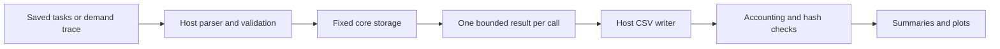

# Implementation notes

`include/emulator` and `src/core` are the target model. `src/host` parses inputs, owns streams and exports records between core steps. Python prepares and runs inputs, checks files, and plots results. CMake builds a separate core library so dependencies can be inspected.

The scheduler keeps an active prefix of a fixed job array. Releases append a job, completion returns a copy and fills its slot with the last active job. Priority selection scans active jobs, so array order does not decide scheduling. The running index stays fixed until completion. At most one completion occurs at a tick boundary. A returned completion must be consumed before calling `step` again; the CLI does that synchronously. There is no growing event queue and completed jobs do not accumulate in the core.

The host uses static-duration Scheduler and Replay objects to avoid large stack allocations. Tests use static core objects too. The scheduler holds one 65,536-byte arena; Replay holds separate static and dynamic arenas, so it reserves two such arrays even though one policy is active at a time. Both host command objects are part of the program's fixed storage; only one mode executes. Selecting a 512-byte budget restricts the active prefix and does not shrink either compiled array.

On the recorded Apple Clang arm64 build, Scheduler is 330,208 bytes (264,672 outside its arena); Replay is 132,960 (1,888 outside its two arenas). StaticArena metadata is 296 bytes, DynamicArena metadata 808. These implementation-specific sizes include alignment/padding, not host parser/output objects or all process RAM. Fixed capacities are 16 tasks, 4,096 active jobs, 32 blocks and eight-byte alignment. Reported full object sizes are not just policy metadata, and policy metadata is not charged to the experimental payload budget.

`docs/verification/stack-usage.txt` records compiler -O3 per-function estimates: Scheduler init 176 bytes and step 144 bytes after removal of a large array-reset temporary. These are not runtime stack high-water marks or complete call-chain budgets. There are no recursive core calls. Large arrays have explicit fixed storage duration; small bounded locals are used for configuration and returned records.

Static memory keeps owner offsets and requested capacities; padding cannot be accessed as extra owner payload. Bounds checks subtract only after proving offset <= capacity. Dynamic allocation keeps a sorted fixed array of descriptors with offsets, sizes and used flags. Splitting needs a free descriptor. An exact-fit request can still succeed at descriptor capacity. Free scans for a currently allocated exact offset and merges adjacent holes. Stale host pointers are never involved: replay resolves request IDs to handles and validates pending lifetimes before freeing.

The host validates trace ordering, distinct request IDs, owner maxima, one pending request per owner, matching frees and complete lifetimes before running. It limits a trace to 1,000,000 events, bounding memory counters and peak-demand sums in the tested API contract. Core replay additionally checks local lifetime/order constraints. The replay API is not an untrusted general-purpose allocator service.

Timing preflight computes release counts and total work with uint64 checks, checks deadline addition, checks the H+work stop bound and conservatively bounds response sums and scan counters. Every cost is positive. Job capacity is a runtime bound because priority can create backlog even when aggregate work is calculable.

The test executable replaces scalar/array, ordinary/aligned, throwing/nothrow new forms, with matching delete forms. Allocation counting is active for all core tests and a deliberate ordinary/aligned allocation proves the hook fires. Placement new does not allocate and is not intercepted. This is evidence for tested paths, not interception of malloc or every library operation. The core source audit rejects direct C allocation calls, heap containers and prohibited host facilities; nm checks undefined allocation symbols. The audit and explicit I/O-free source boundary complement the C++ guard. They do not claim that the whole host process never allocates.

No optional preemptive comparator or segmented yields were implemented. The core has no target overhead cost model. Keep future changes small enough that the hand-worked timelines remain useful correctness oracles.
