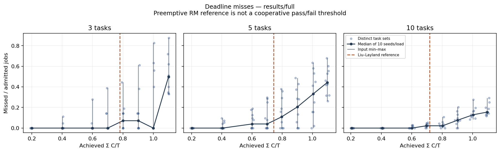
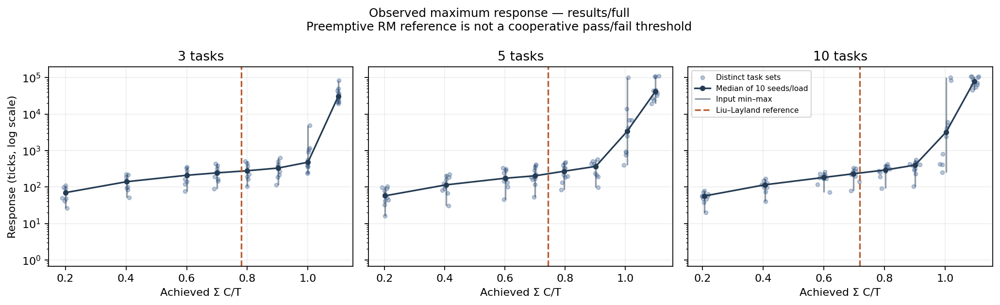
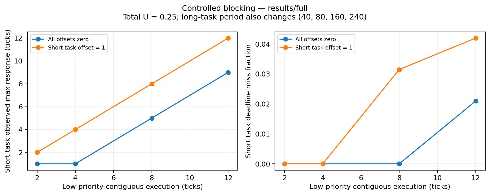
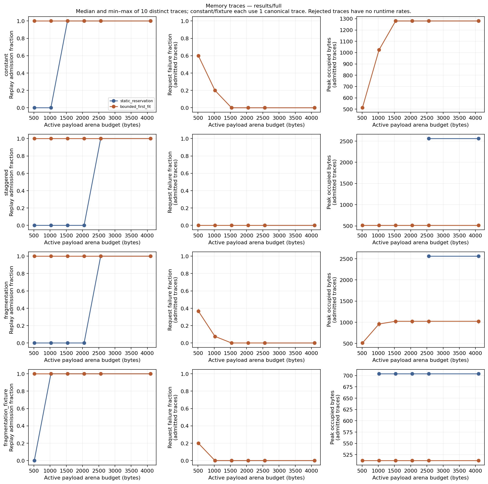

# Emulator results explained

The C++ emulator was run against the complete experiment plan. The results show that completion-yield cooperative scheduling can execute all admitted work while still missing deadlines, and that static memory is predictable when sufficiently provisioned but reserves more space than runtime sharing needs for some lifetimes.

This document explains the saved measurements in plain language. It uses the existing raw data and summaries; no new experiments or invented measurements were added. See [findings.md](findings.md) for the shorter evidence note and [methodology.md](methodology.md) for the exact workload rules.

## 1. What actually ran

The full batch contains 525 planned outcomes:

| Experiment | What it investigated | Completed runs | Static admission rejections | Total |
| --- | --- | ---: | ---: | ---: |
| E0 | Small, manually checkable scheduling examples | 3 | 0 | 3 |
| E1 | Increasing offered CPU load with 3, 5 or 10 tasks | 240 | 0 | 240 |
| E2 | Long jobs blocking a high-priority task | 8 | 0 | 8 |
| E3 | Memory demand, allocation policies and arena budgets | 181 | 83 | 264 |
| E4 | Scheduling and static memory together | 2 | 2 | 4 |
| Sensitivity | Longer runs and different release offsets | 6 | 0 | 6 |
| **Total** | | **440** | **85** | **525** |

There were **no incomplete full-batch simulations**. The scheduling runs admitted and completed **1,163,718 jobs**, including jobs finishing after arrivals stopped.

The 85 rejections are expected budget outcomes: the declared static reservations did not fit, so those configurations were refused before execution. They are not 85 crashes. Conversely, the 440 completed runs are not 440 cases where every deadline and memory request succeeded. “Complete” describes whether execution/replay finished and its outcomes were recorded.

The plan deliberately includes difficult and insufficient-budget cases. An overall percentage of “completed” runs would not be a useful measure of how good the scheduling or memory policy is.

Evidence: [batch manifest](../results/full/manifest.json), [status counts](../results/full/analysis/status_counts.csv) and [analysis record](../results/full/analysis/analysis.json).

## 2. What the measurements mean

| Measurement | Meaning in this project |
| --- | --- |
| Tick | One unit of simulated time. It is not a measured millisecond on the host computer. |
| Task/job | A task is the recurring specification; a job is one particular release of that task. |
| Offered utilisation | Sum of execution cost / period, written as `U = sum(C/T)`. It describes the requested processor work. |
| Observed CPU occupancy | Busy execution ticks in the release window divided by the window length. It cannot exceed 100%. |
| Response time | Completion time minus release time. It includes time waiting for another job. |
| Observed maximum response | The largest response in this finite set of admitted jobs. It is not a proven bound for every future run. |
| Deadline miss | A job finishes later than its absolute deadline. Each late job is counted once. |
| Backlog/drain | Unfinished admitted jobs at the release horizon, and the extra time needed to finish them after arrivals stop. |
| Admission rejection | The policy refuses to start because its required static reservations do not fit the budget. |
| Allocation failure | A particular runtime request cannot be satisfied while a memory trace is being replayed. |

For example, offered utilisation of 110% means the tasks request more work than one processor can sustainably deliver. The processor itself still executes at most one tick of work per tick; unfinished work accumulates. At light average utilisation, individual long jobs can still delay a short-deadline job.

“Nominal” load is the generator's requested target. Execution costs must be positive integers, so actual achieved load differs slightly after rounding. Figures use achieved utilisation. Memory budgets below are **active payload-arena bytes**, not total physical RAM: fixed backing arrays and metadata remain reserved outside this comparison.

## 3. E0: the small examples behaved as expected

E0 gives a check that output rows correspond to understandable schedules.

- The single-task example completed three jobs, each with response time 2 ticks, and had no misses.
- The equal-period example dispatched the smaller task ID first, as specified.
- The blocking example completed all three admitted jobs, but one missed its deadline.

The blocking example is especially useful:

| Job | Released | Deadline | First start | Completed | Response | Result |
| --- | ---: | ---: | ---: | ---: | ---: | --- |
| Low-priority task 2, job 0 | 0 | 20 | 0 | 7 | 7 | On time |
| High-priority task 1, job 0 | 1 | 6 | 7 | 8 | 7 | Missed by 2 ticks |
| High-priority task 1, job 1 | 6 | 11 | 8 | 9 | 3 | On time |

The high-priority job released at tick 1 cannot interrupt the job already running. It waits until tick 7, executes for one tick, and finishes at tick 8. Priority determines the next dispatch; it does not cause preemption in this model.

Evidence: [blocking job rows](../results/full/e0/e0_blocking/jobs.csv), [single-task summary](../results/full/e0/e0_single/runs.csv), [tie example](../results/full/e0/e0_ties/jobs.csv).

## 4. E1: increasing CPU demand made deadline misses more common

E1 contains eight target loads, three task counts and ten seeds: 240 simulations. Each used a 100,000-tick release horizon, followed by drain. Deadlines equalled periods, and release offsets were zero.

This table counts **whole task sets with no deadline misses**. There are ten sets for each task count at each target load.

| Nominal load | Actual achieved load range across all 30 sets | 3 tasks: no misses / 10 | 5 tasks: no misses / 10 | 10 tasks: no misses / 10 | Total with no misses / 30 |
| --- | --- | ---: | ---: | ---: | ---: |
| 20% | 19.000–21.875% | 10 | 10 | 10 | 30 |
| 40% | 39.250–41.625% | 8 | 6 | 10 | 24 |
| 60% | 58.000–61.875% | 8 | 5 | 6 | 19 |
| 70% | 68.750–71.750% | 7 | 5 | 2 | 14 |
| 80% | 78.000–81.750% | 5 | 4 | 2 | 11 |
| 90% | 88.375–91.625% | 5 | 3 | 2 | 10 |
| 100% | 98.250–102.000% | 6 | 1 | 0 | 7 |
| 110% | 108.500–111.125% | 0 | 0 | 0 | 0 |

All 30 synchronous low-load cases met their deadlines. As demand increased, fewer task sets had zero misses. All 30 overloaded cases missed at least one deadline.

The trend is not strictly monotonic for every task count: six three-task cases had zero misses at nominal 100%, compared with five at 90%. Integer costs and the selected harmonic periods change how jobs fit together. Also, the nominal 100% cell includes actual loads below and above 100%. This is why the results do not identify one universal cooperative utilisation threshold.

At nominal 110%, the following statistics describe the ten input sets for each task count:

| Task count | Median job deadline miss rate | Median of each run's observed maximum response | Range of run maximum responses |
| --- | ---: | ---: | --- |
| 3 | 49.78% | 30,798 ticks | 19,320–83,356 ticks |
| 5 | 44.35% | 41,185.5 ticks | 19,527–110,009 ticks |
| 10 | 15.53% | 79,697 ticks | 46,108–108,520 ticks |

These percentages are median **job miss rates**, not percentages of task sets. Every overloaded set had at least one miss. The response median can have a half-tick because it averages the two middle integer observations from ten runs; the emulator still uses integer ticks.

A smaller median miss fraction for ten tasks does not mean that adding tasks improves this scheduler. The task families have different periods, execution shares and release counts. The ten-task group also has a larger median maximum response here. A small fraction of very delayed jobs can matter even if many short jobs finish on time.

### Reading the two utilisation figures



The x-axis is achieved offered utilisation. The y-axis is the fraction of admitted jobs that missed deadlines. Dots show distinct input sets; the median line and min–max bars describe the ten inputs at each target load. The bars are not confidence intervals.



The response graph uses a logarithmic y-axis: a move from 100 to 1,000 ticks is a tenfold increase. The sharp rise in overloaded cases reflects jobs waiting behind accumulated work, including during drain. The 110,009-tick response is possible even with a 100,000-tick release horizon because admitted jobs are allowed to finish after that horizon.

The dashed Liu–Layland line is a theoretical sufficient reference for preemptive rate-monotonic scheduling under its assumptions. This emulator is cooperative, so being below that line does not guarantee success here. Exceeding a sufficient reference bound also does not prove failure. Its assumptions are explained in [methodology.md](methodology.md).

Evidence: [combined scheduling results](../results/full/analysis/schedule_runs.csv) and [per-condition medians/ranges](../results/full/analysis/summary.csv). The no-miss counts above were calculated from individual E1 run rows, not inferred from a median of zero.

## 5. E2: long uninterrupted jobs caused misses at only 25% total load

E2 held the short, high-priority task at execution cost 1 and period/deadline 5. The long task's cost increased from 2 to 12 ticks. Its period increased proportionally, keeping long-task utilisation at 5% and combined utilisation at 25%.

Two release phases were tested: both tasks first release at zero, or the short task first releases one tick after the long task starts. Each condition admitted 2,000 high-priority jobs.

| Long cost / period | Short-task offset | Short-task maximum response | Short-task misses / 2,000 | Miss rate |
| --- | ---: | ---: | ---: | ---: |
| 2 / 40 | 0 | 1 tick | 0 | 0% |
| 4 / 80 | 0 | 1 tick | 0 | 0% |
| 8 / 160 | 0 | 5 ticks | 0 | 0% |
| 12 / 240 | 0 | 9 ticks | 42 | 2.10% |
| 2 / 40 | 1 | 2 ticks | 0 | 0% |
| 4 / 80 | 1 | 4 ticks | 0 | 0% |
| 8 / 160 | 1 | 8 ticks | 63 | 3.15% |
| 12 / 240 | 1 | 12 ticks | 84 | 4.20% |

A response of exactly 5 ticks meets the short task's relative deadline of 5. Responses above that miss it. The offset-one condition is more exposed to blocking because a long job is already running when the short job arrives.



The lesson is that average spare processor capacity does not guarantee short response times. A processor can be idle much of the time and still be unavailable at the exact interval a short-deadline job needs. Priority alone cannot overcome a running job's uninterrupted execution in this completion-yield policy.

The long task's period and number of releases also change in this experiment. The measurements support this controlled blocking comparison; they do not establish execution length as the only factor in every possible workload.

Evidence: [blocking summary](../results/full/analysis/blocking_summary.csv) and the individual run folders under [E2](../results/full/e2/).

## 6. Sensitivity: release timing matters, even at low load

Six sensitivity runs used the five-task seed-1 family at a 200,000-tick horizon: three loads, each with zero or staggered offsets. Each admitted 9,250 jobs.

| Nominal load | Release offsets | Missed jobs | Miss rate | Run maximum response | Drain time |
| --- | --- | ---: | ---: | ---: | ---: |
| 20% | Zero | 0 | 0% | 91 ticks | 0 ticks |
| 20% | Staggered | 250 | 2.70% | 60 ticks | 0 ticks |
| 80% | Zero | 3,500 | 37.84% | 394 ticks | 0 ticks |
| 80% | Staggered | 3,745 | 40.49% | 240 ticks | 110 ticks |
| 110% | Zero | 6,295 | 68.05% | 47,814 ticks | 19,000 ticks |
| 110% | Staggered | 6,264 | 67.72% | 47,644 ticks | 19,174 ticks |

The low-load case is important. Both versions have the same actual offered load of 20.75%, but staggering releases changes when jobs encounter the long running task. Low offered load alone therefore does not guarantee that all release phases meet deadlines.

The staggered case's run maximum falls from 91 to 60 ticks while its misses increase. This is not contradictory: different tasks have different deadlines. In the raw task metrics, task 1 has a 50-tick relative deadline and maximum response 51 ticks, causing all 250 misses. Task 5 has a much looser 800-tick deadline; its maximum response falls from 91 to 60 without missing either way. A single maximum across every task hides that distinction.

Doubling the overloaded zero-offset run from 100,000 to 200,000 release ticks increased drain time from 9,500 to 19,000 ticks and maximum response from 24,192 to 47,814 ticks. These longer observations show accumulated delay growing in the overloaded case; they do not prove a finite indefinite response bound.

These are six specific checks, not an exhaustive study of all offsets or horizons.

Evidence: [sensitivity runs](../results/full/sensitivity/), [staggered low-load task metrics](../results/full/sensitivity/sensitivity_u20_staggered/task_metrics.csv) and [zero-offset low-load task metrics](../results/full/sensitivity/sensitivity_u20_zero/task_metrics.csv).

## 7. E3: memory results depend on demand and lifetime

E3 replayed the same demand traces under both policies at budgets 512, 1,024, 1,536, 2,048, 2,560 and 4,096 bytes.

- `static_reservation`: reserve every owner's declared maximum before starting. Insufficient total reservation causes admission rejection.
- `bounded_first_fit`: allocate and free blocks inside the same-sized bounded payload arena as requests arrive. Individual requests may fail, but replay continues so all outcomes are recorded.

The two policies are compared on matching trace bytes, not different random demand streams. The generated families each have ten distinct traces and 500 requests per trace. The constant trace and manual fixture each use one canonical input, rather than pretending duplicate copies are independent samples.

### Constant demand: enough memory is still necessary

Five simultaneous owners request 256 bytes each, so useful simultaneous demand is 1,280 bytes. The constant trace contains 500 requests.

| Payload budget | Static outcome | First-fit failed requests | First-fit peak occupied bytes |
| --- | --- | ---: | ---: |
| 512 | Rejected | 300 / 500 (60%) | 512 |
| 1,024 | Rejected | 100 / 500 (20%) | 1,024 |
| 1,536 | Admitted; no request failures | 0 / 500 | 1,280 |
| 2,048 | Admitted; no request failures | 0 / 500 | 1,280 |
| 2,560 | Admitted; no request failures | 0 / 500 | 1,280 |
| 4,096 | Admitted; no request failures | 0 / 500 | 1,280 |

Runtime sharing cannot fit all simultaneous requests into less space than they actually require. First-fit starting a replay at 512 bytes is not a better all-requests-succeed result than static rejecting it: first-fit records substantial runtime failures instead. At sufficient capacity both policies satisfy this trace.

### Staggered demand: reuse needs much less active arena space

Each of five owners declares a maximum of 512 bytes. Static reservations therefore require 2,560 bytes. The trace lifetimes do not overlap: an owner frees its request before another owner needs the arena.

All ten first-fit staggered traces had zero failures at a 512-byte budget, with peak occupancy 512 bytes. Static rejected every budget below 2,560. At a common budget of 2,560 bytes both policies succeeded:

| Measurement | Static reservation | Bounded first-fit |
| --- | ---: | ---: |
| Declared total owner maxima | 2,560 bytes | Same demand contract |
| Peak useful live payload | 512 bytes | 512 bytes |
| Peak occupied arena bytes | 2,560 bytes | 512 bytes |
| Request failures | 0 | 0 |

In this family, first-fit's peak occupied arena space is one fifth of static's. Static keeps each owner's maximum available even while most owners are inactive. First-fit can reuse that space across non-overlapping lifetimes.

This workload deliberately exposes temporal reuse. It does not show that every application can reduce its memory budget by 80%. Nor does choosing a 512-byte active budget reduce the emulator's compiled arrays or total process memory by 80%.

### Fragmentation: enough total free bytes can still be unusable

The hand-worked fixture starts with four adjacent 128-byte allocations in 512 bytes. Freeing alternating blocks gives this layout:

```text
[128 free][128 used][128 free][128 used]
```

There are 256 free bytes overall, but the largest hole is 128 bytes. A 192-byte allocation fails because no single contiguous hole fits. This is an actual fragmentation-related failure, distinct from having fewer than 192 total free bytes. Its later free is recorded as skipped because no block was allocated.

Across the ten longer generated fragmentation traces:

| Budget | Median request failure rate | Range across traces | Median fragmentation-related failures / 500 requests | Fragmentation failure count range |
| --- | ---: | --- | ---: | --- |
| 512 bytes | 36.70% | 34.40–39.60% | 31 | 20–37 |
| 1,024 bytes | 7.60% | 6.00–9.60% | 38 | 30–48 |
| 1,536 bytes | 0% | 0–0% | 0 | 0–0 |
| 2,048 bytes | 0% | 0–0% | 0 | 0–0 |
| 2,560 bytes | 0% | 0–0% | 0 | 0–0 |
| 4,096 bytes | 0% | 0–0% | 0 | 0–0 |

The median fragmentation count increases from 31 to 38 when the budget increases from 512 to 1,024, while the total failure rate falls. Earlier capacity failures affect which allocations remain live and therefore which holes form later. At 1,024, the saved outcomes have fewer total failures but more classified as fragmentation. Fragmentation counts alone are not a complete quality measure.

The static contract for these generated traces declares 512 bytes for each owner, including owners whose realised requests are smaller. Static consequently requires 2,560 bytes; it rejects lower tested budgets, and has no request failures once admitted. The declared maxima are a controlled input assumption, not proof that every owner actually needs its maximum in every trace.

### Reading the memory figure



Each row is a trace family. The three columns answer different questions:

1. Was the trace admitted for replay?
2. Among admitted traces, what fraction of requests failed?
3. Among admitted traces, how many arena bytes were occupied at the peak?

A dynamic admission fraction of 1 means replay can begin, not that every request succeeds. Static rejection has no runtime failure rate; there was no admitted execution to measure. Missing static points in the runtime columns are therefore not zeros.

Evidence: [memory summaries](../results/full/analysis/memory_summary.csv), [individual memory run summaries](../results/full/analysis/memory_runs.csv) and [manual fragmentation events at 512 bytes](../results/full/e3/e3_fragmentation_fixture_s0_b512_bounded_first_fit/memory_events.csv).

## 8. E4: scheduling and fixed task memory worked together, but deadlines still mattered

The integrated example uses five tasks with 256 reserved bytes each, requiring 1,280 bytes before execution. It tests a moderate and a high load under two budgets.

| Nominal / actual offered load | Budget | Outcome | Jobs completed | Deadline misses | Miss rate | Run maximum response | Drain |
| --- | ---: | --- | ---: | ---: | ---: | ---: | ---: |
| 60% / 60.375% | 1,024 | Admission rejected | No jobs admitted | Not applicable | Not applicable | Not applicable | Not applicable |
| 60% / 60.375% | 1,536 | Complete | 4,625 | 875 | 18.92% | 289 ticks | 0 ticks |
| 100% / 100.125% | 1,024 | Admission rejected | No jobs admitted | Not applicable | Not applicable | Not applicable | Not applicable |
| 100% / 100.125% | 1,536 | Complete | 4,625 | 2,936 | 63.48% | 757 ticks | 125 ticks |

Every admitted job performed four checked region operations: two writes and two reads. Each successful run therefore recorded 18,500 accesses. This demonstrates that the cooperative scheduler and owner-bounded static memory coexist in the same implementation.

Memory admission and deadline feasibility answer separate questions. Providing enough memory allowed execution, but did not make the supplied task set meet all deadlines. The moderate case still missed 18.92% of job deadlines. The high-load case's actual demand is slightly above 100% after integer rounding, which helps explain its full main-window occupancy and subsequent drain.

These cases do not measure allocator latency affecting deadlines: memory accesses and bookkeeping cost zero target ticks in the model.

Evidence: [moderate-load admitted run](../results/full/e4/e4_u60_b1536/runs.csv), [higher-load admitted run](../results/full/e4/e4_u100_b1536/runs.csv) and [rejected-budget run](../results/full/e4/e4_u60_b1024/runs.csv).

## 9. What this answers about the research questions

| Research question | What the evidence supports | Practical implication |
| --- | --- | --- |
| RQ1: How effective is cooperative scheduling without a target OS? | The declared policy is deterministic and executes admitted work, with zero misses for some finite workloads. Blocking, load and release phase cause misses in others, including at low average load. | Bound contiguous execution and examine each task's deadline/phase; total utilisation alone is insufficient. |
| RQ2: Is static memory viable compared with dynamic management? | Static gives fixed owner capacity and predictable admission. First-fit uses much less active space for non-overlapping demand, but encounters capacity and fragmentation failures under constrained budgets. | Provision static maxima when predictability is valuable; evaluate realistic lifetimes before relying on reuse. Neither policy wins every criterion. |
| RQ3: How relevant are Voyager-inspired principles today? | Simple scheduling and explicit fixed storage can be implemented together, with inspectable resource bounds and observable trade-offs. | The principles offer useful design ideas for comparable constraints. Applicability is a reasoned interpretation of these experiments, not a numerical score or evidence of spacecraft reliability. |

The emulator producing deadline misses and allocation failures is not evidence that the implementation failed to run. Those outcomes are part of what the experiments were built to observe. A meaningful result can be a correctly reproduced limitation of a chosen policy.

## 10. How much confidence to place in these results

The implementation was checked against small hand-worked timelines and allocator fixtures. Normal and sanitizer test suites passed. Accounting checks reconcile job/task/run totals and memory snapshots. A fresh build reproduced 62 smoke runs with all 216 corresponding raw files byte-identical to the full batch. The full batch's raw hashes are saved and were checked after cleanup.

Those checks support correctness and repeatability of the implemented finite model. They do not establish hardware timing or unlimited generality:

- Inputs are synthetic, with researcher-selected periods, costs, deadlines, maxima and lifetimes.
- The main scheduling family uses zero offsets and a small harmonic period set; the six sensitivity cases are limited.
- Tick costs are supplied demands, not measured embedded WCET. No host runtime is reported as target CPU performance.
- Scheduling, allocation and memory-operation overhead add zero target ticks. No measured speed advantage of static allocation is established.
- The dynamic comparison is one bounded first-fit implementation, not every dynamic allocator or host `malloc`.
- Active arena budgets exclude fixed metadata, and smaller budgets do not shrink compiled storage.
- Interrupts, caches, peripherals, energy and real fault/recovery behaviour are outside the model.
- No optional preemptive comparator or physical hardware validation was implemented.
- Medians and ranges describe the saved distinct inputs. Repeated deterministic runs and policy/budget pairs are not additional independent samples, and the ranges are not confidence intervals.

For a compact technical statement of the same evidence, use [findings.md](findings.md). For the exact definitions and full limitations, use [data-dictionary.md](data-dictionary.md) and [limitations.md](limitations.md).
